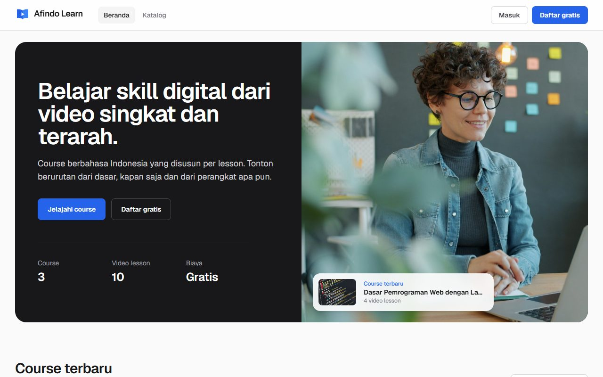
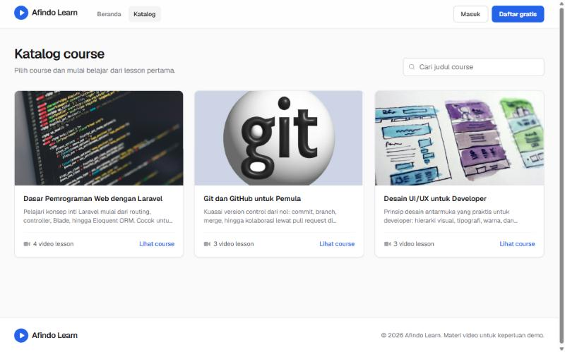
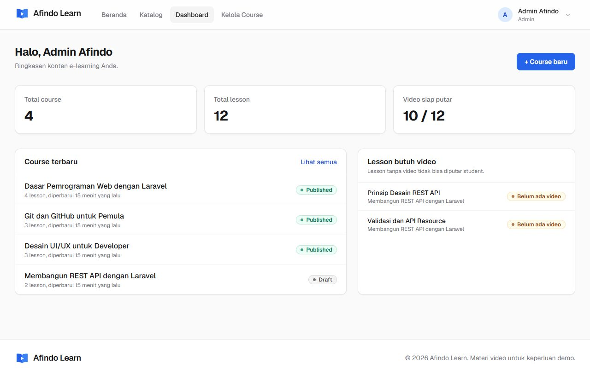
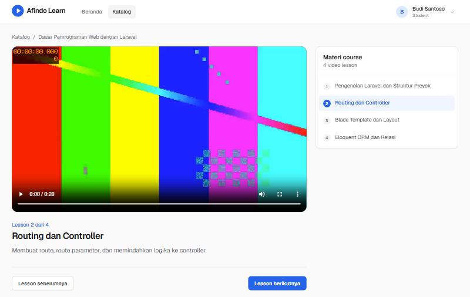
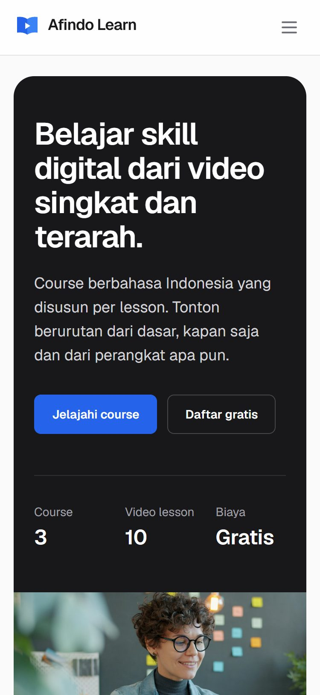
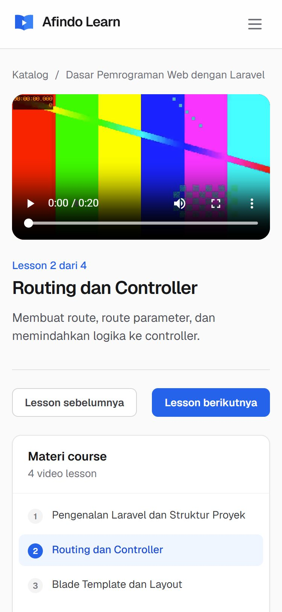
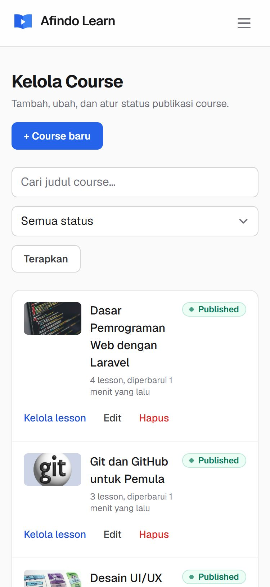

# Afindo Learn: Simple E-Learning Platform

Aplikasi e-learning sederhana berbasis **Laravel** untuk Technical Assessment Web Developer (Track A).
Admin mengelola course dan lesson berupa video; student menjelajahi katalog, membuka detail course, lalu menonton lesson secara berurutan.



## Daftar isi

- [Ringkasan](#ringkasan)
- [Fitur](#fitur)
- [Alur pemakaian](#alur-pemakaian)
- [Teknologi](#teknologi)
- [Arsitektur dan struktur proyek](#arsitektur-dan-struktur-proyek)
- [Kebutuhan](#kebutuhan)
- [Instalasi](#instalasi)
- [Konfigurasi](#konfigurasi)
- [Menjalankan](#menjalankan)
- [Akun demo](#akun-demo)
- [Batas upload video](#batas-upload-video)
- [Testing dan QA](#testing-dan-qa)
- [Halaman dan route](#halaman-dan-route)
- [Dokumentasi](#dokumentasi)
- [Troubleshooting](#troubleshooting)
- [Keterbatasan](#keterbatasan)
- [Kredit](#kredit)

## Ringkasan

Afindo Learn punya dua area utama:

| Area | Pengguna | Fungsi |
|---|---|---|
| Publik dan student | Guest, student | Beranda, katalog course, detail course, dan player lesson. Menonton video wajib login. |
| Admin | Admin | CRUD course, CRUD lesson, mengurutkan lesson, dan upload video lesson. |

Alurnya mengikuti platform kursus pada umumnya: siapa pun bisa melihat katalog dan daftar materi, tetapi isi video baru bisa diakses setelah login. Setelah login, user langsung dikembalikan ke lesson yang tadi dipilih.

Beberapa keputusan penting:

- Video disimpan di disk **private** dan hanya bisa diputar lewat route yang memeriksa login serta role.
- Thumbnail course disimpan di disk **public** karena bukan data sensitif dan perlu tampil cepat untuk guest.
- Halaman dirender server dengan Blade, tanpa SPA dan tanpa API publik terpisah.
- Course berstatus **draft** tidak muncul di katalog dan tidak bisa dibuka student (404).

Pemetaan tiap poin brief ke implementasi dan test ada di [docs/BRIEF-COMPLIANCE.md](docs/BRIEF-COMPLIANCE.md).

## Fitur

### Admin

- Login dengan role admin. Seluruh route `/admin` dijaga middleware `role:admin`.
- Dashboard berisi jumlah course, jumlah lesson, jumlah video siap putar, course terbaru, dan daftar lesson yang belum punya video.
- Course: lihat, cari, filter status, tambah, ubah, dan hapus.
  - Data: judul, deskripsi, thumbnail (opsional), dan status publikasi (draft atau published).
  - Daftar course memakai paginasi dan bisa difilter berdasarkan judul maupun status.
- Lesson: tambah, ubah, hapus, dan **urutkan dengan drag and drop**.
  - Lesson baru otomatis mendapat posisi terakhir.
  - Urutan tersimpan otomatis lewat request JSON setelah item dilepas.
  - Menghapus lesson ikut menghapus file videonya dan merapatkan kembali nomor urut.
- Upload video lesson:
  - Dikirim lewat XHR agar ada **progress bar** dan tidak memuat ulang halaman saat proses berjalan.
  - Format yang diterima: MP4, WebM, atau OGG.
  - Ukuran maksimum mengikuti batas aplikasi (500 MB) atau batas PHP, mana yang lebih kecil.
  - Status video: `pending` -> `uploading` -> `ready` atau `failed`.
  - Video lama dihapus setelah video baru berhasil disimpan.
- Menghapus course ikut menghapus seluruh lesson, folder video, dan thumbnail milik course tersebut.

### Guest dan student

- Beranda, katalog, dan detail course bisa dibuka tanpa login.
- Katalog bisa dicari berdasarkan judul course.
- Detail course menampilkan deskripsi, thumbnail, daftar lesson, dan tombol mulai belajar.
- Menonton lesson wajib login. Guest yang membuka lesson diarahkan ke halaman login, lalu dikembalikan ke lesson yang dituju setelah berhasil masuk.
- Player lesson menyediakan navigasi lesson sebelumnya dan berikutnya, daftar materi di samping video, dan penanda lesson yang sedang aktif.
- Video hanya bisa diakses lewat route berotorisasi. Student tidak bisa memutar video dari course draft.
- Student tidak bisa membuka area admin (403) dan tidak bisa melakukan aksi manajemen course atau lesson.

### Tampilan

| Katalog course | Dashboard admin | Player lesson |
|---|---|---|
|  |  |  |

| Beranda (mobile) | Player (mobile) | Kelola course (mobile) |
|---|---|---|
|  |  |  |

## Alur pemakaian

1. Admin login, lalu membuka dashboard.
2. Admin membuat course baru, mengisi judul, deskripsi, thumbnail, dan status.
3. Admin menambahkan lesson pada course tersebut.
4. Admin mengunggah video untuk setiap lesson dan menunggu statusnya menjadi `ready`.
5. Admin mengatur urutan lesson dengan drag and drop.
6. Admin mengubah status course menjadi `published` agar tampil di katalog.
7. Guest atau student membuka katalog, memilih course, lalu membuka detail course.
8. Student login, lalu diarahkan kembali ke lesson yang dipilih dan bisa memutar videonya.

## Teknologi

| Teknologi | Alasan singkat |
|---|---|
| Laravel 13, PHP 8.3+ | Diwajibkan brief; routing, validasi, Eloquent, policy, dan storage tersedia tanpa library tambahan untuk fitur inti. |
| MySQL 8 | Diwajibkan brief. SQLite dipakai untuk pengembangan lokal dan test. |
| Blade + Alpine.js | Halaman dirender di server; Alpine cukup untuk upload, drag and drop, modal, dan menu mobile. Tidak perlu SPA. |
| Laravel Breeze | Scaffolding login, register, dan profil resmi Laravel. |
| Tailwind CSS | Token warna, font, dan spacing dikelola di satu konfigurasi. |
| SortableJS | Drag and drop urutan lesson, ringan dan mendukung layar sentuh. |
| XHR | Upload video memakai `XMLHttpRequest` karena punya event progress upload. |
| Pest 4 | Feature test untuk alur admin, student, dan otorisasi video. |

Tidak ada API publik terpisah. Halaman dirender Blade, dan dua endpoint JSON (upload video dan reorder lesson) hanya dipakai internal halaman admin dengan session serta CSRF.

## Arsitektur dan struktur proyek

Alur request utama:

```text
Route -> Middleware (auth, role:admin) -> Controller -> FormRequest -> Model -> Database
                                                    -> Policy (akses video)
                                                    -> Storage (video private, thumbnail public)
```

Poin arsitektur:

- **Controller tipis.** Validasi dipindah ke FormRequest, aturan otorisasi video di `LessonPolicy`, dan logika model di Eloquent.
- **Video private.** File disimpan di `storage/app/private/videos/course-{id}/lesson-{id}/`. Satu-satunya jalan membuka file adalah `GET /lessons/{lesson}/video`, yang memeriksa login dan policy lalu mengirim `BinaryFileResponse` (mendukung HTTP Range untuk seek).
- **Thumbnail public.** Disimpan di `storage/app/public/thumbnails/` dan butuh `php artisan storage:link`.
- **Hapus berantai.** Course memakai foreign key cascade untuk lesson, lalu event model membersihkan folder video dan thumbnail.
- **Posisi lesson.** Kolom `position` tidak unique agar proses reorder yang menulis banyak baris sekaligus tidak bentrok di tengah transaksi.

Struktur folder utama:

```text
app/
  Enums/                       UserRole, CourseStatus, VideoStatus
  Http/
    Controllers/
      Admin/                   DashboardController, CourseController, LessonController
      Student/                 CourseController, LessonController
      LessonVideoController.php upload dan streaming video
    Middleware/EnsureUserHasRole.php  middleware role:admin
    Requests/Admin/            CourseRequest, LessonRequest
  Models/                      User, Course, Lesson
  Policies/LessonPolicy.php    siapa yang boleh menonton video
resources/
  js/                          video-uploader.js, lesson-sorter.js
  views/                       admin/, student/, components/, layouts/
database/
  migrations/                  users, courses, lessons
  seeders/                     UserSeeder, CourseSeeder, images/, videos/
routes/web.php                 route publik, auth, dan admin
tests/
  Feature/                     test Pest untuk semua alur utama
  e2e/                         skrip QA HTTP dan browser (Playwright)
docs/                          DESIGN.md, PDF desain, laporan QA
design/                        file FigCraft, preview PNG, dan PDF preview
```

File yang paling sering dibaca saat review:

| File | Isi |
|---|---|
| `app/Http/Controllers/LessonVideoController.php` | Upload video, validasi, status, dan streaming dengan Range. |
| `app/Policies/LessonPolicy.php` | Aturan akses video untuk admin dan student. |
| `app/Http/Middleware/EnsureUserHasRole.php` | Middleware `role:admin`. |
| `app/Http/Controllers/Admin/LessonController.php` | CRUD lesson dan reorder. |
| `database/seeders/CourseSeeder.php` | Data demo course, lesson, dan video contoh. |
| `routes/web.php` | Daftar route dan middleware. |

## Kebutuhan

- PHP **8.3+** dengan ekstensi `pdo_mysql`, `fileinfo`, `mbstring`, `openssl`, dan `gd`.
- Composer 2.
- Node.js **20.19+ atau 22.12+** dan npm.
- MySQL 8 atau MariaDB 10.6+.
- SQLite sebagai alternatif cepat tanpa MySQL (lihat Opsi B).

## Instalasi

### 1. Ambil source code dan dependency

Clone repository atau ekstrak arsip ZIP, lalu jalankan dari folder proyek:

```bash
git clone https://github.com/Crown-us/afindo-test.git
cd afindo-test

composer install
npm install

cp .env.example .env
php artisan key:generate
```

### 2. Siapkan database

**Opsi A: MySQL** (sesuai brief). Buat database kosong bernama `afindo_elearning`, lalu sesuaikan `.env` bila perlu:

```env
DB_CONNECTION=mysql
DB_HOST=127.0.0.1
DB_PORT=3306
DB_DATABASE=afindo_elearning
DB_USERNAME=root
DB_PASSWORD=
```

**Opsi B: SQLite** (untuk mencoba cepat tanpa MySQL). Ubah `DB_CONNECTION` menjadi `sqlite`, hapus lima baris `DB_HOST` sampai `DB_PASSWORD`, lalu buat file database kosong:

```env
DB_CONNECTION=sqlite
```

```bash
php -r "touch('database/database.sqlite');"
```

### 3. Migrasi, data demo, storage, dan aset

```bash
php artisan migrate --seed
php artisan storage:link
npm run build
```

`storage:link` diperlukan agar thumbnail course tampil. Langkah 1 sampai 3 juga bisa dijalankan sekaligus dengan `composer run setup` setelah database di `.env` siap.

## Konfigurasi

Variabel `.env` yang paling berpengaruh:

| Variabel | Nilai contoh | Keterangan |
|---|---|---|
| `APP_NAME` | `Afindo Learn` | Nama aplikasi di title dan footer. |
| `APP_URL` | `http://localhost:8000` | URL dasar aplikasi. |
| `APP_LOCALE` | `id` | Bahasa antarmuka dan pesan validasi. |
| `DB_CONNECTION` | `mysql` | `mysql` atau `sqlite`. |
| `DB_DATABASE` | `afindo_elearning` | Nama database atau path file SQLite. |
| `FILESYSTEM_DISK` | `local` | Disk default. Video memakai disk `local` (private). |
| `SESSION_DRIVER` | `database` | Sesi disimpan di tabel `sessions`. |
| `QUEUE_CONNECTION` | `database` | Tidak dipakai untuk fitur wajib karena semua proses sinkron. |

Catatan: `APP_URL` tidak dipakai untuk URL thumbnail karena thumbnail memakai `asset('storage/...')`, sehingga tetap tampil meskipun aplikasi dijalankan di port atau domain lain.

## Menjalankan

```bash
php artisan serve
```

Buka http://localhost:8000.

Saat mengembangkan, jalankan server Laravel dan Vite sekaligus:

```bash
composer run dev
```

Alternatif tanpa Vite dev server (setelah `npm run build`):

```bash
php artisan serve
```

## Akun demo

Semua akun memakai password **`password`**.

| Role | Nama | Email |
|---|---|---|
| Admin | Admin Afindo | `admin@afindo.test` |
| Student | Budi Santoso | `student@afindo.test` |
| Student | Siti Rahmawati | `siti@afindo.test` |

Data demo berisi 4 course dan 12 lesson:

- 3 course published dengan video contoh di setiap lesson.
- 1 course draft tanpa video, untuk mencoba alur upload.

Panduan langkah demo ada di [docs/DEMO-GUIDE.md](docs/DEMO-GUIDE.md).

Mengembalikan data ke kondisi awal:

```bash
php artisan migrate:fresh --seed
```

## Batas upload video

Batas efektif adalah nilai terkecil antara batas aplikasi (500 MB) dan konfigurasi PHP (`upload_max_filesize`, `post_max_size`). Halaman upload selalu menampilkan batas yang sedang berlaku.

Bawaan PHP hanya 2 MB, sehingga halaman upload akan menampilkan "Maksimal 2 MB". Ada dua cara menaikkannya:

1. **Tanpa mengubah php.ini.** Jalankan server bawaan PHP dari folder `public`:

   ```bash
   cd public
   php -d upload_max_filesize=512M -d post_max_size=520M -S 127.0.0.1:8000 ../vendor/laravel/framework/src/Illuminate/Foundation/resources/server.php
   ```

   Opsi `-d` tidak ikut terbawa jika dipakai bersama `php artisan serve`, jadi gunakan perintah ini.

2. **Permanen.** Ubah `php.ini` menjadi `upload_max_filesize = 512M` dan `post_max_size = 520M`, lalu restart server.

Jika file melebihi `post_max_size`, server dapat membalas 413 sebelum request sampai ke Laravel. UI sudah menangani kasus ini dengan pesan "File terlalu besar untuk server".

## Testing dan QA

### Pest

```bash
php artisan test
```

Test memakai SQLite in-memory (lihat `phpunit.xml`), jadi tidak menyentuh database lokal. Hasil saat ini: **89 test, 315 assertion, semuanya lulus**.

Untuk menjalankan di MySQL, buat database kosong (misalnya `afindo_elearning_test`) lalu set environment variable sebelum test:

```bash
DB_CONNECTION=mysql DB_DATABASE=afindo_elearning_test php artisan test
```

Cakupan utama:

- Login admin dan student, pembatasan role, dan register yang selalu menghasilkan student.
- CRUD course, CRUD lesson, validasi, dan reorder.
- Upload, ganti, dan hapus video serta thumbnail.
- Streaming video, termasuk HTTP Range dan otorisasi course draft.
- Alur guest membuka lesson, login, lalu kembali ke lesson tersebut.
- Test validasi brief per fitur di `tests/Feature/AssessmentBriefValidationTest.php`.

### QA end-to-end

Selain Pest, tersedia QA HTTP dan browser (Playwright) yang dijalankan terhadap aplikasi dan MySQL: **139 pemeriksaan, semuanya lulus**.

- Laporan lengkap, matriks skenario, dan screenshot: [docs/qa/TEST-PLAN.md](docs/qa/TEST-PLAN.md).
- Skrip: `tests/e2e/qa-http.mjs` dan `tests/e2e/qa-ui.mjs`.
- Cara menjalankan ada di [tests/e2e/README.md](tests/e2e/README.md).

Skrip QA membuat dan menghapus data, jadi jalankan pada database khusus pengujian, bukan database demo.

## Halaman dan route

| Method | URL | Akses | Fungsi |
|---|---|---|---|
| GET | `/` | publik | Beranda |
| GET | `/courses` | publik | Katalog dan pencarian judul |
| GET | `/courses/{course}` | publik | Detail course dan daftar lesson |
| GET | `/courses/{course}/lessons/{lesson}` | login | Player lesson |
| GET | `/lessons/{lesson}/video` | login + policy | Streaming video |
| GET | `/dashboard` | login | Diarahkan ke dashboard admin atau katalog sesuai role |
| GET | `/admin` | admin | Dashboard admin |
| GET/POST/PUT/DELETE | `/admin/courses...` | admin | CRUD course |
| GET/POST | `/admin/courses/{course}/lessons...` | admin | Tambah lesson |
| GET/PUT/DELETE | `/admin/lessons/{lesson}...` | admin | Ubah dan hapus lesson |
| PATCH | `/admin/courses/{course}/lessons/reorder` | admin | Simpan urutan lesson (JSON) |
| POST | `/admin/lessons/{lesson}/video` | admin | Upload video (JSON) |

Route auth bawaan Breeze (`/login`, `/register`, lupa password, verifikasi email, profil) juga aktif.

## Dokumentasi

| Dokumen | Isi |
|---|---|
| [docs/DESIGN.md](docs/DESIGN.md) | System design, ERD, alur, daftar route, UI/UX, asumsi, keterbatasan, dan catatan keamanan |
| [docs/Dokumen-Desain-Afindo-Learn.pdf](docs/Dokumen-Desain-Afindo-Learn.pdf) | Versi PDF dari dokumen desain. Snapshot, versi Markdown tetap menjadi sumber terbaru |
| [docs/BRIEF-COMPLIANCE.md](docs/BRIEF-COMPLIANCE.md) | Matriks kepatuhan tiap poin brief ke implementasi, test, dan dokumen |
| [docs/DEMO-GUIDE.md](docs/DEMO-GUIDE.md) | Panduan demo 5 sampai 10 menit, termasuk skenario dan troubleshooting |
| [docs/qa/TEST-PLAN.md](docs/qa/TEST-PLAN.md) | Laporan QA 139 pemeriksaan, matriks skenario, dan screenshot |
| [design/afindo-learn.figcraft](design/afindo-learn.figcraft) | File desain UI/UX (design system, 9 layar desktop, 3 layar mobile) |
| [design/afindo-learn-preview.pdf](design/afindo-learn-preview.pdf) | Ringkasan visual 13 halaman dari file desain |
| [design/preview/](design/preview/) | Preview PNG per layar |
| [tests/e2e/README.md](tests/e2e/README.md) | Cara menjalankan skrip QA HTTP dan browser |

## Troubleshooting

| Masalah | Penyebab umum | Solusi |
|---|---|---|
| 419 Page Expired saat submit form | Sesi atau token CSRF kedaluwarsa | Muat ulang halaman, pastikan `SESSION_DRIVER=database` dan tabel `sessions` sudah dimigrasi. |
| Thumbnail course tidak tampil | Symlink storage belum dibuat | Jalankan `php artisan storage:link`. |
| Upload video gagal atau 413 | Batas PHP masih 2 MB | Naikkan `upload_max_filesize` dan `post_max_size`, atau pakai perintah `php -S` di atas. |
| `Connection refused` ke MySQL | MySQL belum berjalan atau port salah | Nyalakan MySQL dan sesuaikan `DB_HOST`, `DB_PORT`, dan kredensial di `.env`. |
| Video 404 padahal lesson ada | Video belum berstatus `ready` | Unggah ulang video dan pastikan badge berubah menjadi Siap. |
| Video 403 untuk student | Course masih draft | Ubah status course menjadi published. |
| Halaman blank setelah build | Aset Vite belum dibangun | Jalankan `npm run build` atau `npm run dev`. |
| `composer run setup` gagal | Database di `.env` belum dibuat | Siapkan database terlebih dahulu, lalu ulangi perintah. |

## Keterbatasan

- Belum ada progres belajar, penanda lesson selesai, atau fitur enroll.
- Video tidak ditranscode, tidak dibuatkan thumbnail otomatis, dan tidak memakai HLS.
- Upload berlangsung dalam satu request, jadi file sangat besar bergantung pada batas PHP dan web server (belum ada chunked atau resumable upload).
- Status `uploading` bisa tertinggal jika proses PHP mati di tengah penyimpanan. Admin cukup mengunggah ulang.
- `controlsList="nodownload"` pada player bukan DRM. Video tetap bisa diambil oleh user yang berhak menonton lewat developer tools.
- Verifikasi email belum diaktifkan, meskipun route bawaan Breeze tetap ada.
- QA otomatis dijalankan di MySQL 8.4.9 dan SQLite in-memory; belum diuji di browser selain Chromium.

Daftar lengkap asumsi dan keputusan desain ada di [docs/DESIGN.md](docs/DESIGN.md#9-asumsi) dan [docs/DESIGN.md](docs/DESIGN.md#10-keterbatasan-dan-yang-belum-dikerjakan).

## Kredit

- Foto demo: [Unsplash](https://unsplash.com) dengan Unsplash License. Rincian ada di `database/seeders/images/CREDITS.md`.
- Video contoh: dibuat sendiri dengan FFmpeg (`testsrc2`).
- Framework dan library: Laravel, Laravel Breeze, Tailwind CSS, Alpine.js, SortableJS, dan Pest.
- Font antarmuka: Geist dari [fonts.bunny.net](https://fonts.bunny.net).
- Aplikasi dan data demo dibuat untuk keperluan Technical Assessment Web Developer.
