# Dokumen Desain: Afindo Learn

Dokumen ini menjelaskan rancangan sistem, model data, alur utama, dan keputusan UI/UX untuk aplikasi e-learning sederhana (Technical Assessment, Track A: Web Developer).

Daftar isi:

1. [Ringkasan](#1-ringkasan)
2. [Teknologi dan alasan](#2-teknologi-dan-alasan)
3. [System design](#3-system-design)
4. [Hak akses](#4-hak-akses)
5. [Database / ERD](#5-database--erd)
6. [Alur utama](#6-alur-utama)
7. [Daftar route](#7-daftar-route)
8. [UI/UX](#8-uiux)
9. [Asumsi](#9-asumsi)
10. [Keterbatasan dan yang belum dikerjakan](#10-keterbatasan-dan-yang-belum-dikerjakan)
11. [Catatan keamanan](#11-catatan-keamanan)

---

## 1. Ringkasan

Afindo Learn punya dua area:

| Area | Pengguna | Fungsi |
|---|---|---|
| Publik / Student | Guest dan student | Beranda, katalog course, detail course. Menonton video lesson wajib login. |
| Admin | Admin | CRUD course (judul, deskripsi, thumbnail, status publikasi), CRUD lesson, mengurutkan lesson (drag & drop), upload video lesson dengan progress. |

Alurnya meniru platform kursus pada umumnya (mis. Udemy): siapa pun bisa melihat katalog dan daftar materi, tetapi isi video hanya bisa diakses setelah login. Setelah login, user langsung dikembalikan ke lesson yang tadi dipilih.

## 2. Teknologi dan alasan

| Teknologi | Alasan |
|---|---|
| **Laravel 13 (PHP 8.3+)** | Diwajibkan brief. Sudah menyediakan routing, validasi, Eloquent, policy, dan file storage, jadi tidak perlu library tambahan untuk fitur inti. |
| **MySQL 8** | Diwajibkan brief. Saat pengembangan bisa memakai SQLite (default Laravel) karena semua migrasi memakai tipe kolom standar. |
| **Blade + Alpine.js** | Halaman dirender di server (sederhana, cepat, mudah dijelaskan). Alpine cukup untuk interaksi kecil: progress upload, pratinjau thumbnail, modal konfirmasi, menu mobile. Tidak perlu SPA (Vue/React) untuk kebutuhan ini. |
| **Laravel Breeze** | Scaffolding login/register/profil resmi Laravel, sehingga waktu bisa dipakai untuk fitur e-learning. |
| **Tailwind CSS** | Utility class membuat desain konsisten tanpa menulis CSS terpisah; token warna & font diatur di satu tempat (`tailwind.config.js`). |
| **SortableJS** | Library kecil (tanpa dependensi) untuk drag & drop urutan lesson, mendukung mouse dan layar sentuh. |
| **XMLHttpRequest** | Dipakai untuk upload video karena (berbeda dengan `fetch`) punya event `upload.onprogress` untuk progress bar. |
| **Pest** | Framework test bawaan Breeze; sintaks ringkas untuk feature test. |

Tidak dipakai (sesuai brief, tidak wajib): Redis, queue worker, FFmpeg/transcoding, HLS, object storage.

## 3. System design

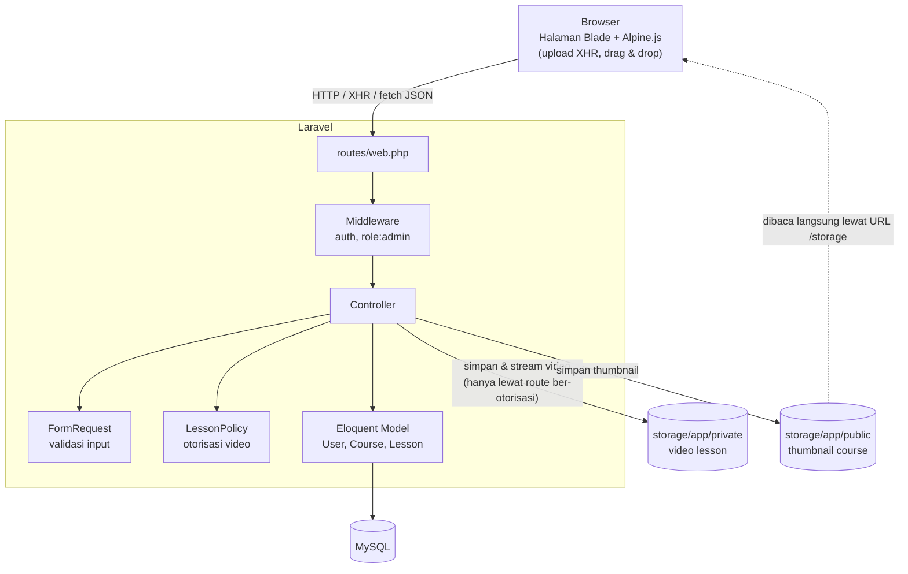

Poin penting:

- **Video disimpan di disk private** (`storage/app/private/videos/course-{id}/lesson-{id}/`). File tidak bisa dibuka lewat URL langsung; satu-satunya jalan adalah route `GET /lessons/{lesson}/video` yang mengecek login dan `LessonPolicy`. Response memakai `BinaryFileResponse`, sehingga mendukung HTTP Range (video bisa di-seek).
- **Thumbnail disimpan di disk public** karena bukan data sensitif dan perlu tampil cepat di katalog untuk guest.
- **Hapus berantai**: menghapus course menghapus lesson (FK cascade) beserta folder video dan thumbnail-nya; menghapus lesson menghapus file videonya dan merapatkan nomor urut lesson yang tersisa.

Struktur kode utama:

```
app/
├── Enums/                     UserRole, CourseStatus, VideoStatus (label & warna badge)
├── Http/
│   ├── Controllers/
│   │   ├── Admin/             DashboardController, CourseController, LessonController
│   │   ├── Student/           katalog, detail course, player lesson
│   │   ├── HomeController     beranda
│   │   └── LessonVideoController  upload (admin) & streaming (admin/student)
│   ├── Middleware/EnsureUserHasRole   role:admin
│   └── Requests/Admin/        CourseRequest, LessonRequest
├── Models/                    User, Course, Lesson
└── Policies/LessonPolicy      siapa boleh menonton video
resources/
├── js/                        lesson-sorter.js, video-uploader.js (komponen Alpine)
└── views/                     admin/, student/, components/, layouts/, home
```

## 4. Hak akses

| Halaman / aksi | Guest | Student | Admin |
|---|---|---|---|
| Beranda, katalog, detail course (published) | Ya | Ya | Ya |
| Detail course draft | 404 | 404 | lewat area admin |
| Halaman player lesson | redirect ke login, lalu kembali ke lesson | Ya (course published) | Ya (course published); video course draft dipratinjau di halaman edit lesson |
| Stream file video | redirect ke login | Ya course published / 403 course draft | Ya |
| Area `/admin/*` (CRUD, reorder, upload) | redirect ke login | 403 | Ya |

Penegakan akses:

- `auth` (Breeze) untuk halaman yang wajib login.
- `role:admin` (`EnsureUserHasRole`) untuk seluruh grup route `/admin`.
- `LessonPolicy::view` untuk streaming video: admin selalu boleh, student hanya jika course sudah published.
- Route lesson memakai `scopeBindings()`, jadi lesson dari course lain di URL menghasilkan 404.
- Kolom `role` tidak *fillable*, sehingga tidak bisa diisi lewat form register/profil. User yang mendaftar sendiri selalu menjadi student.

## 5. Database / ERD

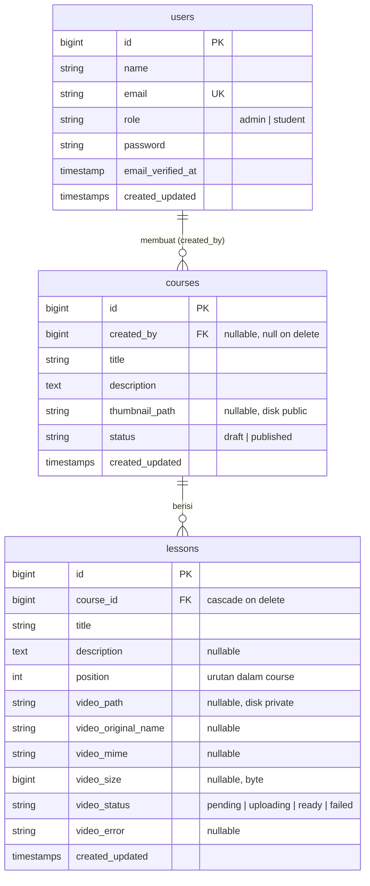

Keputusan desain data:

- **1 lesson = 1 video.** Metadata video disimpan langsung di tabel `lessons`, tidak perlu tabel `videos` terpisah.
- **`role`, `status`, `video_status` disimpan sebagai string**, divalidasi lewat PHP Enum. Menambah nilai baru cukup mengubah Enum tanpa `ALTER TABLE` ENUM MySQL.
- **`position` tidak unique** agar proses reorder (yang menulis ulang banyak posisi sekaligus) tidak bentrok di tengah transaksi. Index `(course_id, position)` mempercepat pengambilan lesson terurut.
- Tabel bawaan Laravel (`sessions`, `cache`, `jobs`, `password_reset_tokens`) tidak digambar karena tidak terkait domain.

## 6. Alur utama

### 6.1 Pengelolaan course dan lesson (admin)

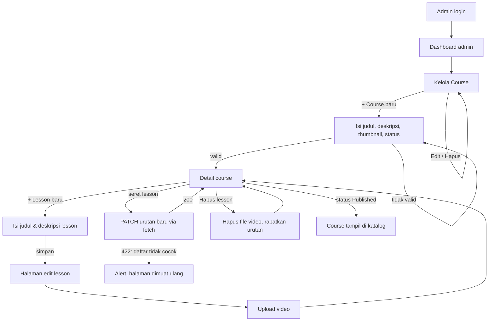

Aturan reorder: server hanya menerima daftar yang berisi **semua** lesson milik course tersebut, tanpa duplikat (`size` + `distinct` + `exists` dengan filter `course_id`), lalu menyimpan posisi di dalam satu transaksi.

### 6.2 Upload video (admin)

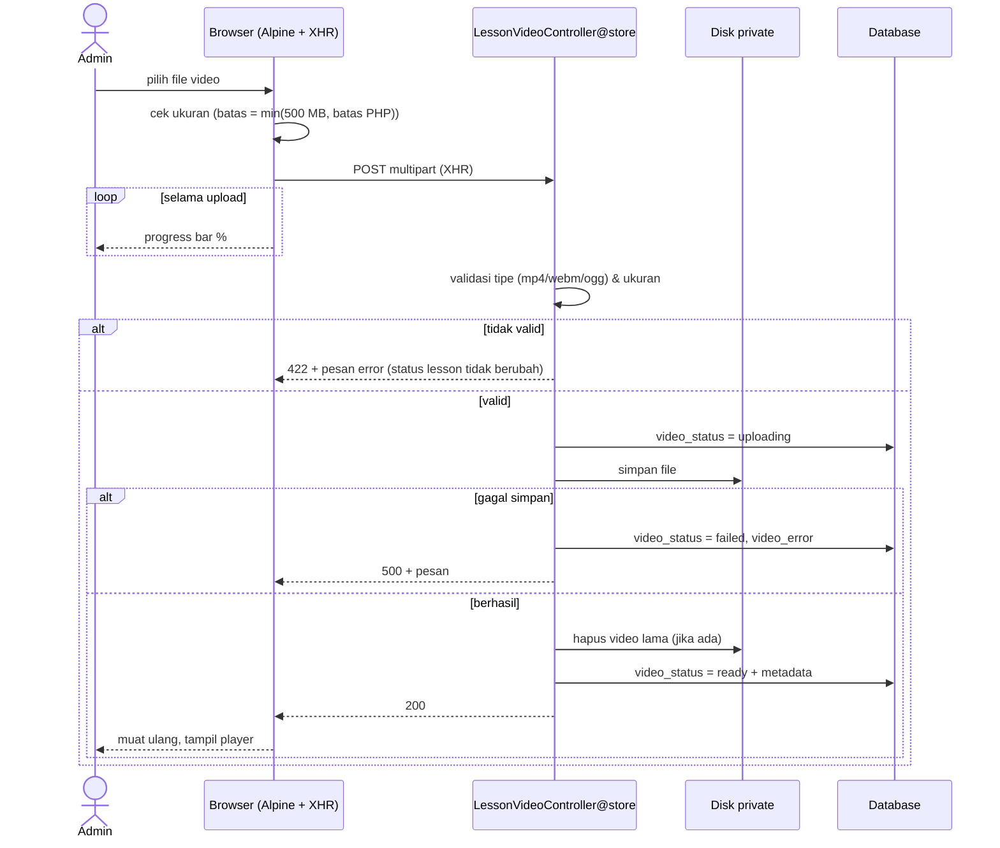

Status video lesson:

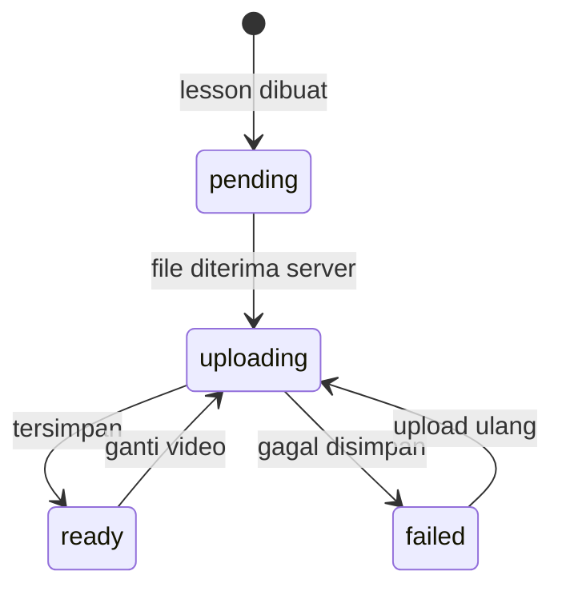

### 6.3 Menonton video (guest / student)

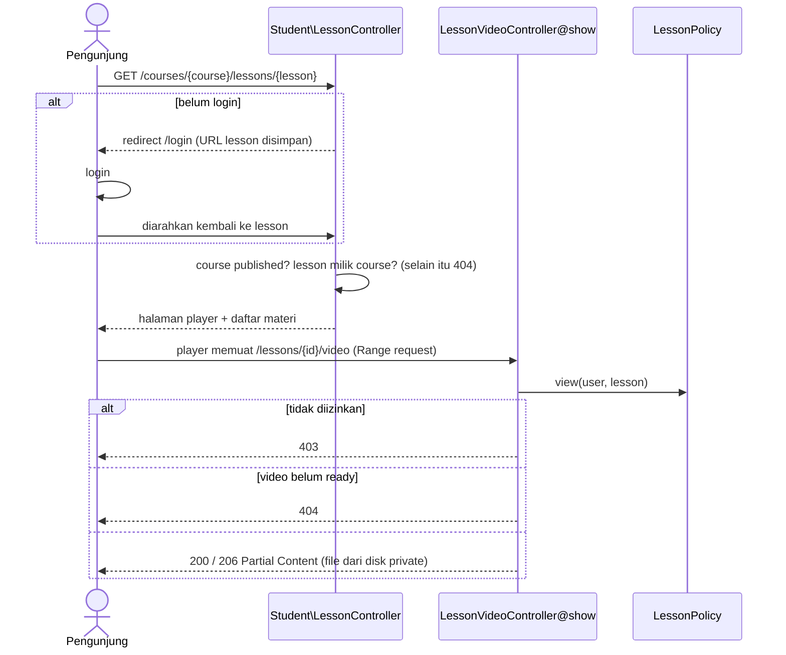

## 7. Daftar route

| Method | URL | Akses | Fungsi |
|---|---|---|---|
| GET | `/` | publik | Beranda |
| GET | `/courses` | publik | Katalog (cari `?q=`) |
| GET | `/courses/{course}` | publik | Detail course + daftar lesson |
| GET | `/courses/{course}/lessons/{lesson}` | login | Player lesson |
| GET | `/lessons/{lesson}/video` | login + policy | Stream file video |
| GET | `/dashboard` | login | Arahkan ke dashboard admin / katalog sesuai role |
| GET | `/admin` | admin | Dashboard admin |
| GET/POST/PUT/DELETE | `/admin/courses...` | admin | CRUD course (resource) |
| GET/POST | `/admin/courses/{course}/lessons/create`, `.../lessons` | admin | Tambah lesson |
| GET/PUT/DELETE | `/admin/lessons/{lesson}...` | admin | Edit / hapus lesson |
| PATCH | `/admin/courses/{course}/lessons/reorder` | admin | Simpan urutan lesson (JSON) |
| POST | `/admin/lessons/{lesson}/video` | admin | Upload video (JSON) |

Ditambah route auth bawaan Breeze (`/login`, `/register`, lupa password, profil).

Tidak ada API publik terpisah. Halaman dirender server dengan Blade; dua endpoint JSON yang ada (`POST /admin/lessons/{lesson}/video` dan `PATCH /admin/courses/{course}/lessons/reorder`) hanya dipakai internal oleh halaman admin dan tetap memakai session + CSRF, bukan token API. Karena itu API design tidak relevan untuk track ini.

### 7.1 Endpoint JSON internal

Dua endpoint berikut bukan API publik. Dipanggil dari halaman admin yang sudah login, memakai session dan CSRF (`X-CSRF-TOKEN`), dan tidak memakai token API.

#### POST /admin/lessons/{lesson}/video

Upload video untuk satu lesson.

- Content-Type: `multipart/form-data`
- Field: `video` (MP4, WebM, atau OGG)
- Batas ukuran: nilai terkecil antara 500 MB dan batas PHP
- Middleware: `auth`, `role:admin`

Contoh request:

```http
POST /admin/lessons/12/video HTTP/1.1
Content-Type: multipart/form-data; boundary=...
X-CSRF-TOKEN: ...
Accept: application/json

--boundary
Content-Disposition: form-data; name="video"; filename="materi.mp4"
Content-Type: video/mp4
...
```

Response berhasil:

```json
{"message":"Video berhasil diunggah."}
```

Response validasi gagal (422):

```json
{"message":"Video harus berupa file bertipe: video/mp4, video/webm, video/ogg.","errors":{"video":["..."]}}
```

Efek: status lesson menjadi `uploading`, lalu `ready` jika file tersimpan, atau `failed` jika penyimpanan gagal. File video lama dihapus setelah file baru berhasil disimpan.

#### PATCH /admin/courses/{course}/lessons/reorder

Menyimpan urutan lesson.

- Content-Type: `application/json`
- Body: `{"lessons":[3,1,2]}`
- Aturan: daftar harus berisi semua lesson milik course tersebut, tanpa duplikat, dan semuanya milik course di URL
- Middleware: `auth`, `role:admin`

Response berhasil:

```json
{"message":"Urutan lesson disimpan."}
```

Response jika daftar tidak lengkap, duplikat, atau berisi lesson dari course lain: `422` dengan pesan validasi.

## 8. UI/UX

File desain: [design/afindo-learn.figcraft](../design/afindo-learn.figcraft) (FigCraft). Isinya tiga halaman: **Design System** (palet warna sebagai paint style, skala tipografi, komponen seperti Button, Badge, Input, Navbar, CourseCard), **Desktop** (9 layar, lebar 1280px), dan **Mobile** (3 layar, lebar 375px). Layar memakai instance komponen, jadi perubahan pada komponen ikut ke semua layar. Preview PNG per layar ada di [design/preview/](../design/preview/), dan ringkasan visualnya tersedia sebagai PDF di [design/afindo-learn-preview.pdf](../design/afindo-learn-preview.pdf). Di file desain, font Geist diganti Inter karena Geist tidak tersedia di FigCraft.

### Prinsip

- **Familiar**: pola mengikuti platform kursus yang sudah dikenal (hero + katalog bergambar, halaman detail dengan kartu "Mulai belajar", player dengan daftar materi di samping).
- **Satu aksi utama per halaman** ditandai tombol biru; aksi lain memakai tombol putih atau link.
- **Status selalu terlihat**: badge status course (Draft/Published) dan status video (Belum ada video / Mengunggah / Siap / Gagal); notifikasi singkat setelah setiap aksi; konfirmasi modal sebelum menghapus.
- **Bahasa Indonesia** yang lugas, termasuk pesan validasi (`lang/id/validation.php`) dan teks bawaan Breeze (`lang/id.json`).

### Token desain

| Token | Nilai | Pemakaian |
|---|---|---|
| Font | Geist (400-700) | Semua teks |
| Warna utama | Tailwind `blue` (tombol `blue-600`) | Tombol utama, link, item aktif |
| Netral | Tailwind `zinc` (dipetakan ke `gray-*`) | Teks, border, latar |
| Gelap | `zinc-900` | Hero beranda, header detail course |
| Status | emerald (siap/published), amber (pending), sky (mengunggah), red (gagal/hapus) | Badge |
| Radius | `rounded-lg` (tombol, input), `rounded-xl` (kartu), `rounded-2xl/3xl` (hero, kartu besar) | |
| Spasi | skala Tailwind 4px; section `py-20`, kartu `p-5/p-6` | |

Komponen Blade yang dipakai ulang: `x-card`, `x-badge`, `x-course-card`, `x-course-thumbnail`, `x-link-button`, `x-primary-button`, `x-confirm-delete` (modal), `x-empty-state`, `x-page-header`, `x-flash`.

### Responsive

- Navbar berubah menjadi menu hamburger di bawah 768px.
- Grid course: 1 kolom (HP), 2 (tablet), 3 (desktop).
- Tabel admin berubah menjadi daftar kartu di HP.
- Player: daftar materi pindah ke bawah video di HP; di desktop menempel di samping.
- Halaman login/daftar: foto hanya tampil di layar lebar.
- Fokus keyboard terlihat (`focus-visible:ring`), elemen interaktif memakai `aria-label`/`aria-current` seperlunya.

### Tampilan halaman yang diimplementasikan

| Beranda | Katalog |
|---|---|
| 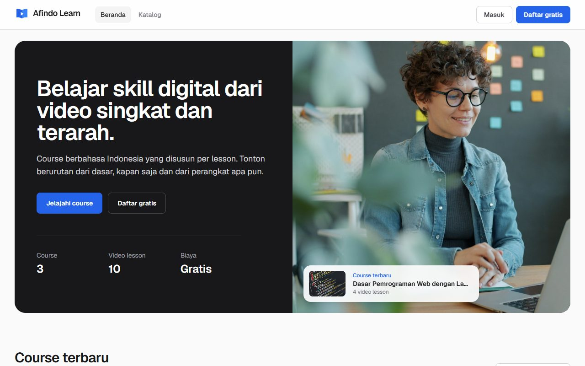 | 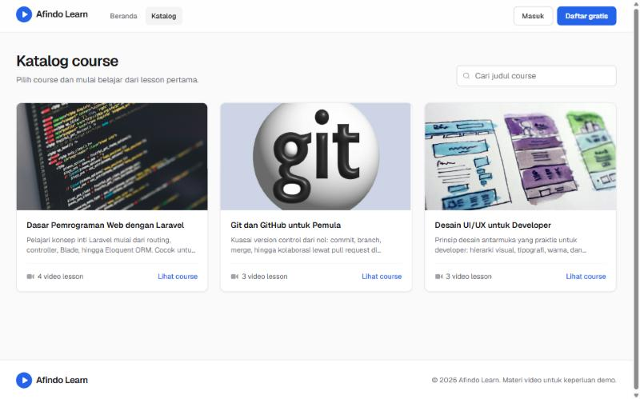 |

| Detail course | Player lesson |
|---|---|
| 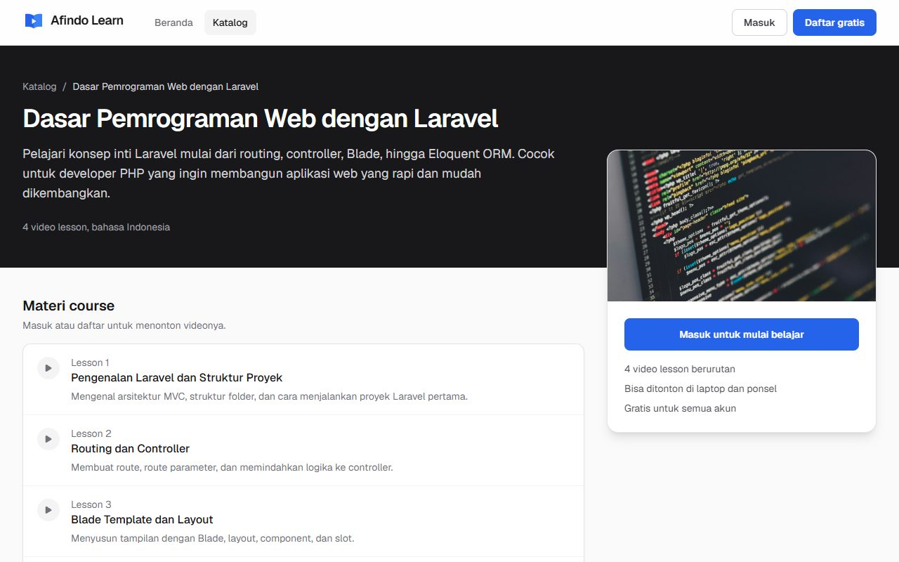 | 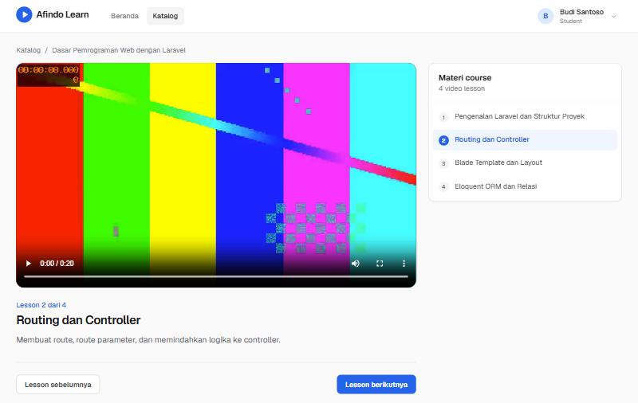 |

| Masuk | Dashboard admin |
|---|---|
| 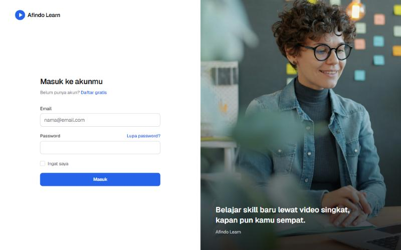 | 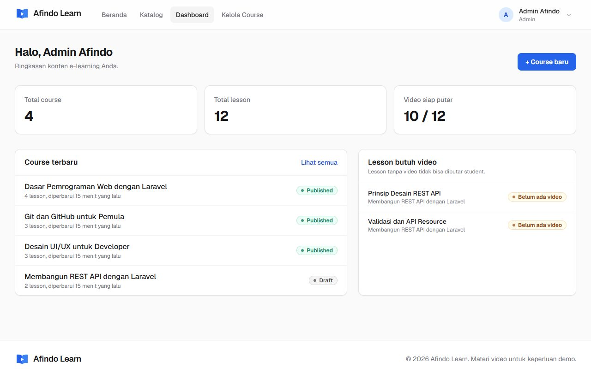 |

| Kelola course | Detail course (admin, drag & drop) |
|---|---|
| 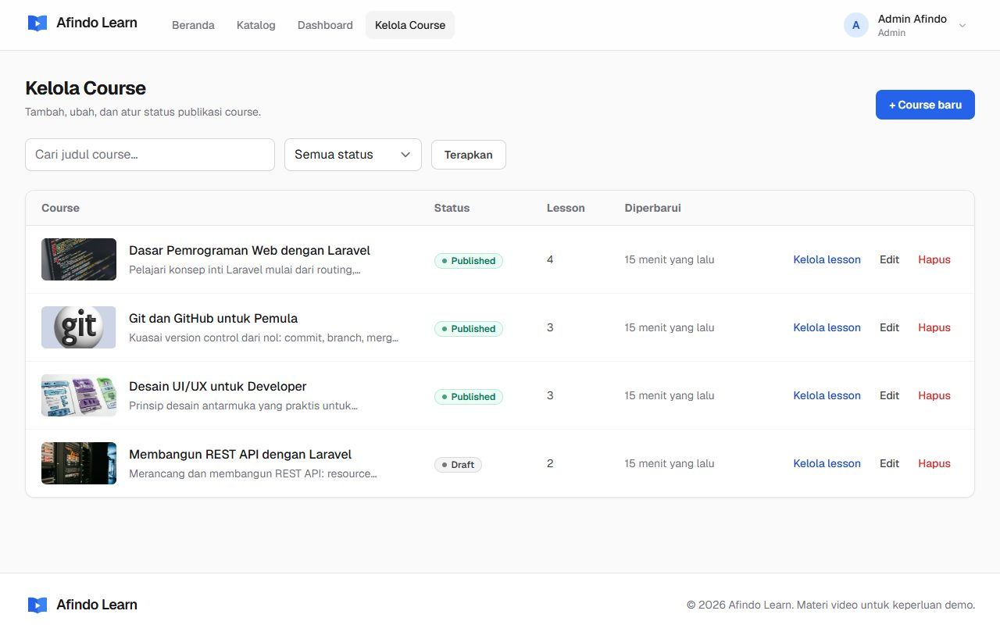 | 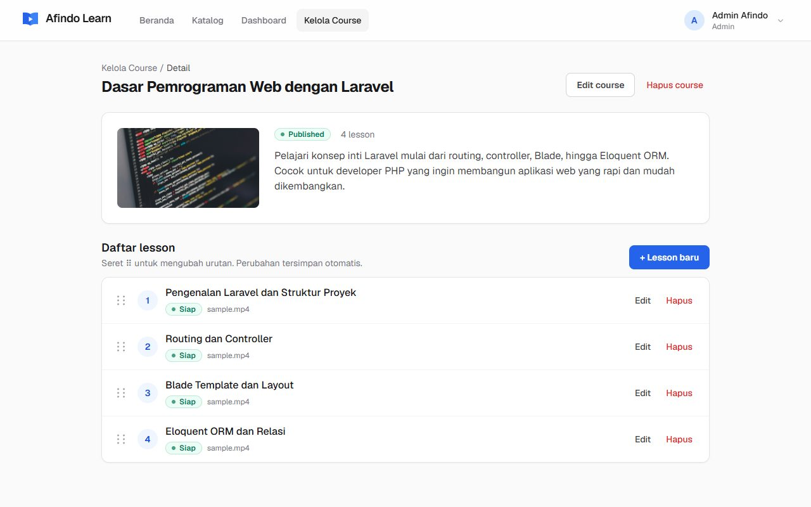 |

| Upload video lesson |
|---|
| 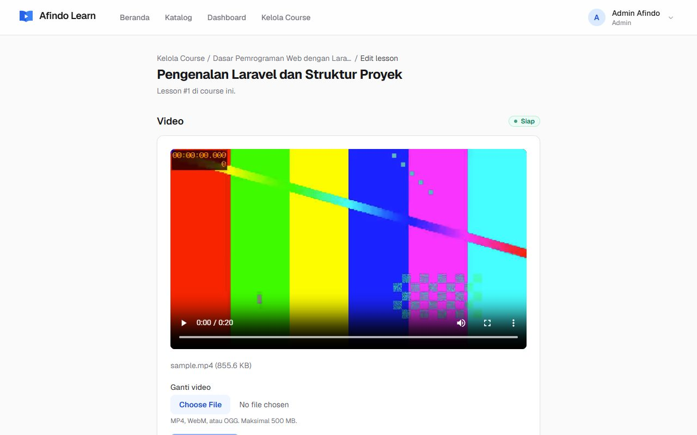 |

Screenshot upload diambil dengan batas upload PHP dinaikkan (lihat README, bagian "Demo upload video berukuran besar"); dengan konfigurasi PHP bawaan halaman ini menampilkan "Maksimal 2 MB".

### Tampilan di ponsel (lebar 375px)

| Beranda | Player lesson | Kelola course (admin) |
|---|---|---|
| 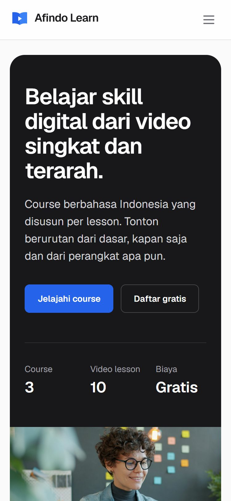 | 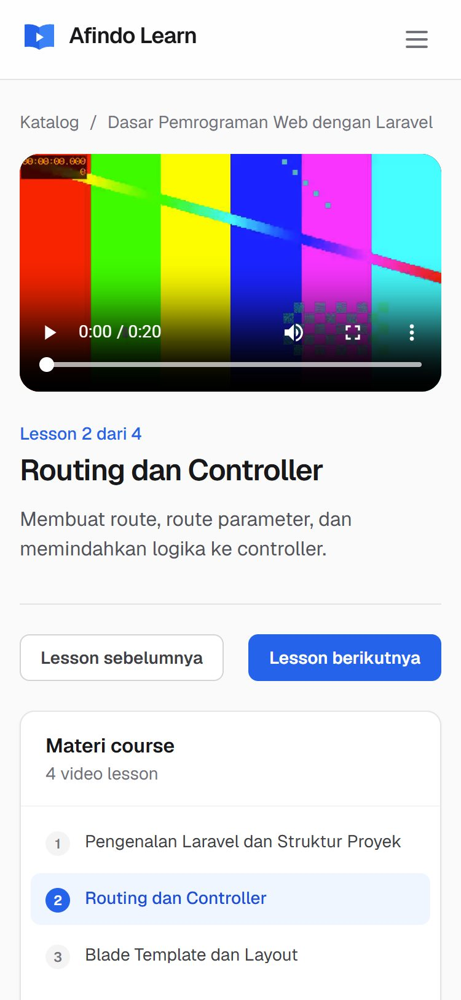 | 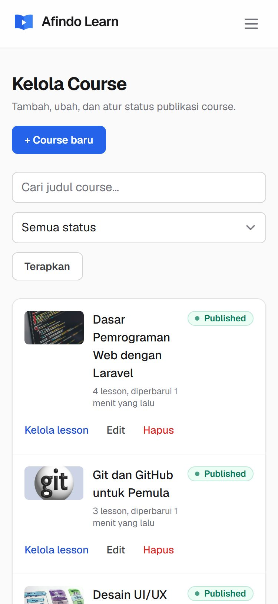 |

## 9. Asumsi

- Satu lesson hanya punya satu video.
- Hanya ada dua role: admin dan student. Akun admin dibuat lewat seeder; pendaftaran publik selalu menghasilkan student.
- Semua course gratis dan terbuka untuk semua student yang login; tidak ada proses enroll/pembayaran.
- Video diunggah dalam format yang sudah bisa diputar browser (MP4/WebM/OGG). Tidak ada konversi format.
- Ukuran upload dibatasi yang terkecil antara 500 MB (batas aplikasi) dan konfigurasi PHP (`upload_max_filesize`, `post_max_size`). UI otomatis menampilkan batas yang berlaku.
- Status `uploading` dicatat saat server mulai menyimpan file. Selama file masih dikirim browser, statusnya ditampilkan oleh progress bar di sisi klien.
- Data demo: video contoh dibuat sendiri dengan FFmpeg (pola warna uji), foto dari Unsplash (lihat `database/seeders/images/CREDITS.md`).

## 10. Keterbatasan dan yang belum dikerjakan

- **Belum ada progres belajar** (tanda lesson selesai, lanjutkan dari terakhir ditonton) dan **belum ada enroll**.
- **Video tidak diproses** (tanpa transcoding, thumbnail video otomatis, durasi, atau HLS). Upload berlangsung dalam satu request, jadi file sangat besar bergantung pada batas PHP/web server dan bisa gagal pada koneksi lambat (belum ada upload ter-chunk / resumable).
- **Status `uploading` bisa tertinggal** jika proses PHP mati di tengah penyimpanan; admin cukup mengunggah ulang.
- **`controlsList="nodownload"` bukan DRM.** Video tetap bisa diambil oleh user yang sudah berhak menontonnya (mis. lewat developer tools); proteksi yang ada adalah otorisasi akses.
- **Verifikasi email belum diaktifkan** (User tidak mengimplementasikan `MustVerifyEmail`); fitur bawaan Breeze tetap ada di kode.
- **Pengujian otomatis** default memakai SQLite in-memory agar cepat. Seluruh migrasi, seeder, dan 89 test juga sudah dijalankan di MySQL 8.4 dan lolos.

## 11. Catatan keamanan

### Kontrol akses

- Halaman yang butuh login memakai middleware `auth`; seluruh route `/admin` memakai `role:admin`.
- Streaming video memakai `LessonPolicy`: admin selalu boleh, student hanya untuk course published. Course draft menghasilkan 404 di halaman publik dan 403 di route video untuk student.
- Route lesson memakai `scopeBindings()`, jadi lesson dari course lain di URL menghasilkan 404.
- Kolom `role` tidak fillable. Register publik selalu menghasilkan student.

### Penyimpanan video

- File video disimpan di disk `local` (`storage/app/private`), di luar document root.
- Route `/storage/{path}` hanya melayani file dengan signed URL. Tanpa signature, request mendapat 403.
- Streaming memakai `BinaryFileResponse` yang mendukung HTTP Range, jadi video bisa di-seek tanpa membuka file langsung.
- Nama file disimpan acak oleh `store()`. Nama asli hanya dipakai sebagai metadata.

### Input dan output

- Semua form memakai CSRF. Request JSON dari halaman admin mengirim `X-CSRF-TOKEN`.
- Validasi input ada di FormRequest: judul, deskripsi, status enum, thumbnail, dan file video (tipe serta ukuran).
- Status course dan video divalidasi lewat PHP Enum, tidak menerima string bebas.
- Output Blade di-escape secara default. Judul dan deskripsi dari admin tidak dirender sebagai HTML mentah.
- Password di-hash oleh cast `hashed`; login memakai rate limiter bawaan Breeze.

### Catatan produksi

- Set `APP_ENV=production` dan `APP_DEBUG=false` saat demo publik.
- Set `APP_URL` memakai HTTPS. Jika di belakang reverse proxy, aktifkan `trustProxies` seperti di `bootstrap/app.php`.
- Ganti password akun demo sebelum membuka aplikasi untuk publik, atau lindungi area admin dengan akses tambahan.
- Jalankan `php artisan storage:link` dan pastikan folder `storage` serta `bootstrap/cache` writable oleh user web server.
- Backup database dan folder `storage/app` secara berkala.
