# QA Test Plan & Report: Afindo Learn

Dokumen ini mencatat rencana pengujian, skenario yang dijalankan, dan hasil eksekusi untuk aplikasi **Afindo Learn** (Technical Assessment Web Developer, Track A).

- **Tanggal eksekusi:** 19 November 2026
- **Hasil akhir:** **139/139 pemeriksaan lulus** (89 Pest + 35 HTTP + 15 browser E2E), tanpa bug fungsional pada alur wajib.
- **Database pengujian:** MySQL `afindo_qa` (terpisah dari database demo/dev), di-seed dengan data demo yang sama (`php artisan migrate:fresh --seed`).

## 1. Environment pengujian

| Komponen | Versi / keterangan |
|---|---|
| OS | Windows 11 Home Single Language (build 26300) |
| PHP | 8.3.36 (ekstensi `pdo_mysql`, `fileinfo`, `mbstring`, `openssl`, `gd`) |
| Framework | Laravel 13.43.0 |
| Database | MySQL 8.4.9 (InnoDB) |
| Node.js | 26.13.0 |
| Browser | Chromium 159.0.8154.6 (Playwright, headless) |
| Viewport UI | Desktop 1366x900; mobile 375x812 (deviceScaleFactor 2) |
| Server | `php -S` dari folder `public`, `upload_max_filesize=512M`, `post_max_size=520M` |

Data uji: 4 course (3 published, 1 draft), 12 lesson (10 punya video), 3 akun demo (`admin@afindo.test`, `student@afindo.test`, `siti@afindo.test`, password `password`).

## 2. Strategi

Pengujian dilakukan tiga lapis supaya perilaku server, UI, dan browser semuanya tercakup:

| Lapis | Alat | Fokus | Jumlah |
|---|---|---|---|
| Regression test | Pest 4 (`php artisan test`) | Aturan bisnis, policy, validasi, CRUD, upload, streaming, di MySQL | 89 test (315 assertion) |
| QA HTTP end-to-end | Playwright `request` (`tests/e2e/qa-http.mjs`) | Status code, redirect, cookie/session, CSRF, otorisasi, isi response, file di disk | 35 skenario |
| QA browser end-to-end | Playwright + Chromium (`tests/e2e/qa-ui.mjs`) | Form sungguhan, upload + progress bar, drag & drop, modal, playback, responsive | 15 skenario |

Pengujian memakai database terpisah `afindo_qa` karena skrip membuat dan menghapus data serta mengunggah file. Database tersebut di-drop setelah pengujian.

## 3. Ringkasan hasil

| Area | Lulus | Gagal |
|---|---:|---:|
| Regression test (Pest, MySQL 8.4.9) | 89 | 0 |
| QA HTTP end-to-end | 35 | 0 |
| QA browser E2E (Playwright) | 15 | 0 |
| **Total** | **139** | **0** |

## 4. Matriks pengujian

### 4.1 Akses publik & autentikasi

| ID | Skenario | Ekspektasi | Hasil |
|---|---|---|---|
| A1 | Guest membuka beranda | 200, hero + daftar course | Lulus |
| A2 | Katalog hanya berisi course published | Draft tidak tampil | Lulus (3 course) |
| A3 | Pencarian katalog | Hanya hasil relevan | Lulus |
| A4 | Pencarian dengan payload SQL injection | Tidak error/bocor | Lulus (200) |
| A5 | Halaman login & register | 200, form tampil | Lulus |
| A6 | Guest membuka lesson | Redirect `/login` | Lulus (302) |
| A7 | Guest mengakses stream video | Redirect `/login` | Lulus (302) |
| B1 | Login admin | 302 -> dashboard, `/admin` 200 | Lulus |
| B2 | Login student | 302, `/admin` 403, dashboard -> katalog | Lulus |
| B3 | Login password salah | Ditolak + pesan error | Lulus |
| B4 | POST tanpa token CSRF | 419 | Lulus |
| B5 | Register dengan `role=admin` | Tetap student, `/admin` 403 | Lulus |
| G1 | Guest buka lesson -> login | Kembali ke lesson yang dituju | Lulus (`/courses/1/lessons/1`) |
| U1 | Login admin lewat form browser | Masuk `/admin` | Lulus |
| U9 | Guest pilih lesson -> login student | Redirect kembali ke lesson, video 206 | Lulus |
| U11 | Student membuka `/admin` | Halaman 403 | Lulus |

### 4.2 Manajemen course & lesson (admin)

| ID | Skenario | Ekspektasi | Hasil |
|---|---|---|---|
| C1 | Dashboard admin | Statistik 4 course, 12 lesson, 10/12 video | Lulus |
| C2 | Filter status + pencarian di kelola course | Hasil terfilter benar | Lulus |
| C3 | Submit form course kosong | Ditolak + pesan validasi | Lulus |
| D1 | Buat course + upload thumbnail | Course dibuat, thumbnail 200 | Lulus |
| D2 | Course draft di katalog publik | Tersembunyi | Lulus |
| D3 | Tambah lesson | Redirect ke edit, posisi terakhir | Lulus |
| D9 | Reorder 3 lesson via PATCH | Tersimpan; payload tidak lengkap 422 | Lulus |
| D10 | Ubah status jadi published | Muncul di katalog publik | Lulus |
| D11 | Hapus lesson | Video terhapus, posisi dirapatkan | Lulus |
| D12 | Hapus course | Course + folder video + thumbnail terhapus | Lulus |
| E1 | Student memanggil endpoint manajemen | 403 | Lulus |
| U3 | Buat course lewat form browser (thumbnail, published) | Course tersimpan | Lulus |
| U4 | Tambah lesson lewat form browser | Lesson tersimpan | Lulus |
| U6 | Drag & drop urutan lesson | Urutan berubah dan persisten setelah reload | Lulus |
| U7 | Modal konfirmasi hapus lesson | Terhapus setelah konfirmasi | Lulus |
| U8 | Hapus course lewat modal | Terhapus, pencarian kosong | Lulus |

### 4.3 Upload & streaming video

| ID | Skenario | Ekspektasi | Hasil |
|---|---|---|---|
| D4 | Upload video via endpoint XHR | 200, file di disk private, status `ready` | Lulus |
| D5 | Upload file non-video | 422, status lesson tidak berubah | Lulus |
| D6 | Stream video + HTTP Range | 200 `video/mp4`; Range -> 206 | Lulus |
| D7 | Student stream video course draft | 403 | Lulus |
| D8 | Admin preview video course draft | Admin 200, student 403 | Lulus |
| U5 | Upload dari browser dengan progress bar | Progress tampil (`Mengunggah... 11%`), lalu badge Siap + preview video | Lulus |
| U10 | Putar video di browser student | `currentTime` berjalan (1,46 s) | Lulus |

### 4.4 Batasan akses & keamanan

| ID | Skenario | Ekspektasi | Hasil |
|---|---|---|---|
| E2 | Student membuka course draft | 404 | Lulus |
| E3 | Lesson milik course lain di URL | 404 | Lulus |
| F1 | Video private lewat URL `/storage/...` | 403 (butuh signed URL) | Lulus |
| F2 | Path traversal ke `.env` | 403/404 | Lulus (403) |
| F3 | Judul course berisi `<script>` | Di-escape, tidak dieksekusi | Lulus |
| U15 | Request lokal 4xx/5xx selama pemakaian normal | Tidak ada | Lulus |

### 4.5 Responsive & UI

| ID | Skenario | Ekspektasi | Hasil |
|---|---|---|---|
| U2 | Halaman kelola course desktop | Tabel tampil | Lulus |
| U12 | Menu hamburger pada 375px | Menu terbuka | Lulus |
| U13 | Grid katalog pada 375px | Satu kolom | Lulus |
| U14 | Kelola course pada 375px | Tabel tersembunyi, kartu tampil | Lulus |

### 4.6 Regression test (Pest)

89 test dijalankan ulang di MySQL 8.4.9 (bukan SQLite in-memory): **89 lulus, 315 assertion, 12,9 detik**. Cakupan: akses per role, CRUD course & lesson, reorder, upload/ganti/hapus video & thumbnail, streaming + HTTP Range, alur guest -> login -> lesson, test bawaan Breeze, serta 26 test validasi brief (A1.1-A1.5) di `tests/Feature/AssessmentBriefValidationTest.php`.

## 5. Temuan

**Tidak ditemukan bug fungsional** pada fitur wajib maupun aturan otorisasi. Semua skenario di atas lulus dan sesuai dokumen desain.

Catatan/observasi (bukan bug, sudah terdokumentasi sebagian di README/design doc):

1. **Thumbnail tidak punya fallback bila file hilang.** Saat database dan isi `storage/app/public/thumbnails` tidak sinkron, gambar course gagal dimuat (request `/storage/...` -> 403 dari route signed-URL) dan hanya muncul ikon rusak. Saran kecil: tampilkan placeholder di komponen `x-course-thumbnail` bila file tidak ada.
2. **Font memakai CDN eksternal** (`fonts.bunny.net`). Saat jaringan membatasi domain tersebut, halaman tetap tampil dengan font fallback, tetapi tampilan tidak persis seperti screenshot. Untuk demo offline, pertimbangkan self-host font Geist.
3. **Batas upload mengikuti PHP** (bawaan 2 MB). Untuk demo upload besar, README sudah menyediakan perintah `php -S` dengan `-d upload_max_filesize=512M`; skrip QA UI memakai cara ini.
4. **Status `uploading` bisa tertinggal** jika proses PHP mati di tengah upload (sudah tercatat di bagian keterbatasan design doc); admin cukup mengunggah ulang.
5. **Belum ada test untuk status `failed`.** Status ini hanya muncul saat penyimpanan file gagal (mis. disk penuh), sulit disimulasikan tanpa mocking; saat ini diverifikasi lewat pembacaan kode, bukan test otomatis.
6. **Video tidak ditranscode** (sesuai batasan brief): file harus sudah dalam format yang bisa diputar browser.

## 6. Bukti screenshot

| Dashboard admin | Kelola course | Form course baru |
|---|---|---|
| 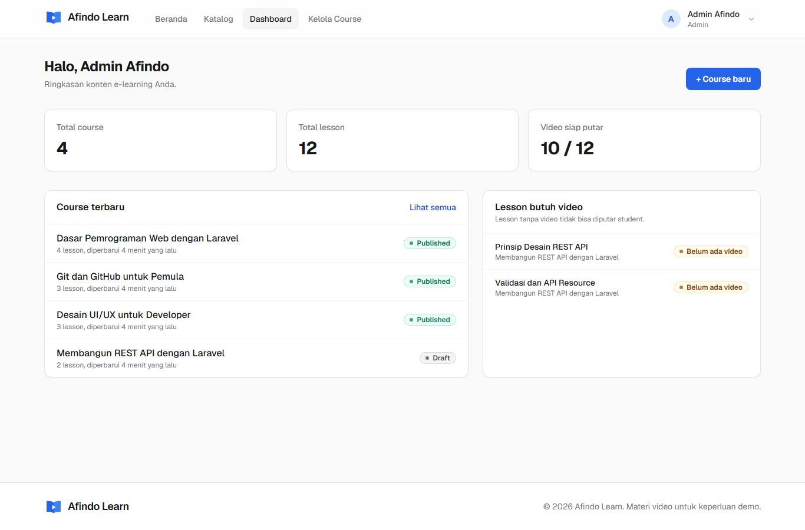 | 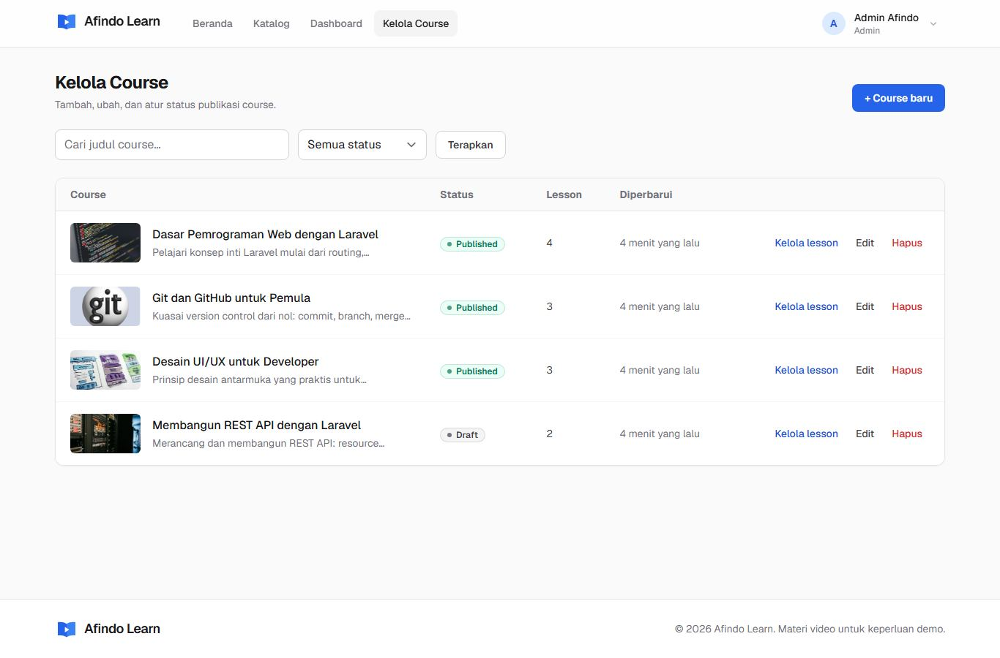 | 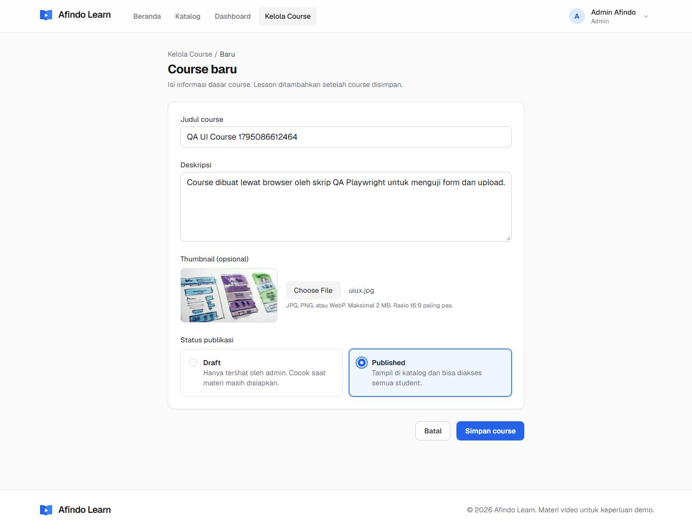 |

| Upload video (progress) | Video siap diputar | Reorder lesson |
|---|---|---|
| 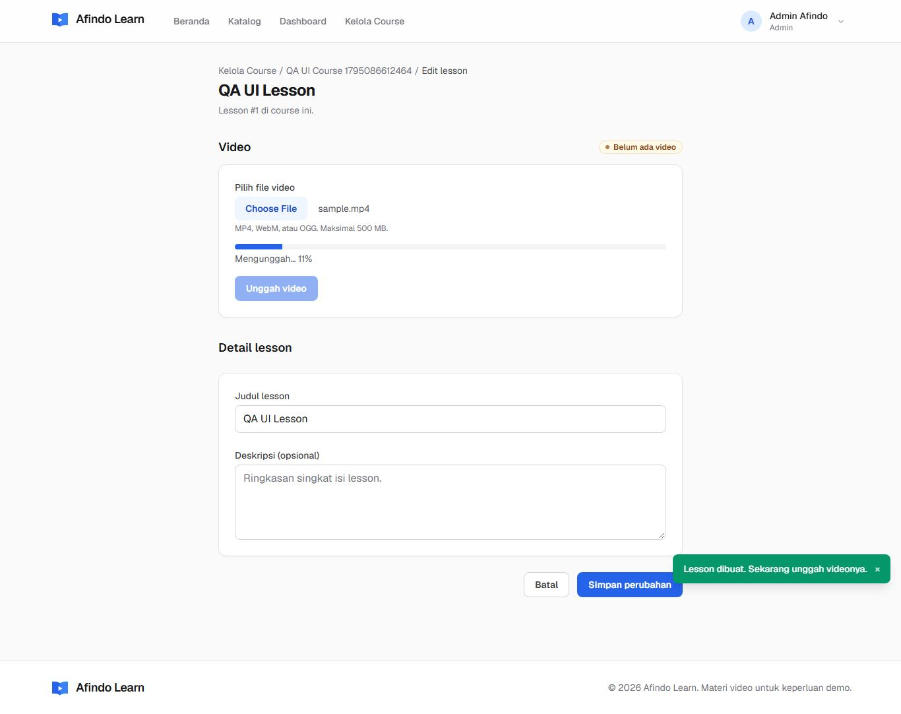 | 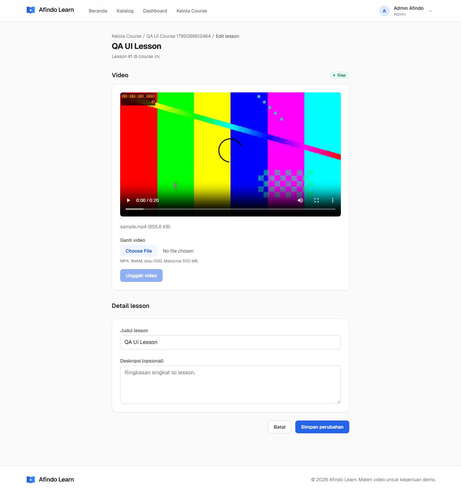 | 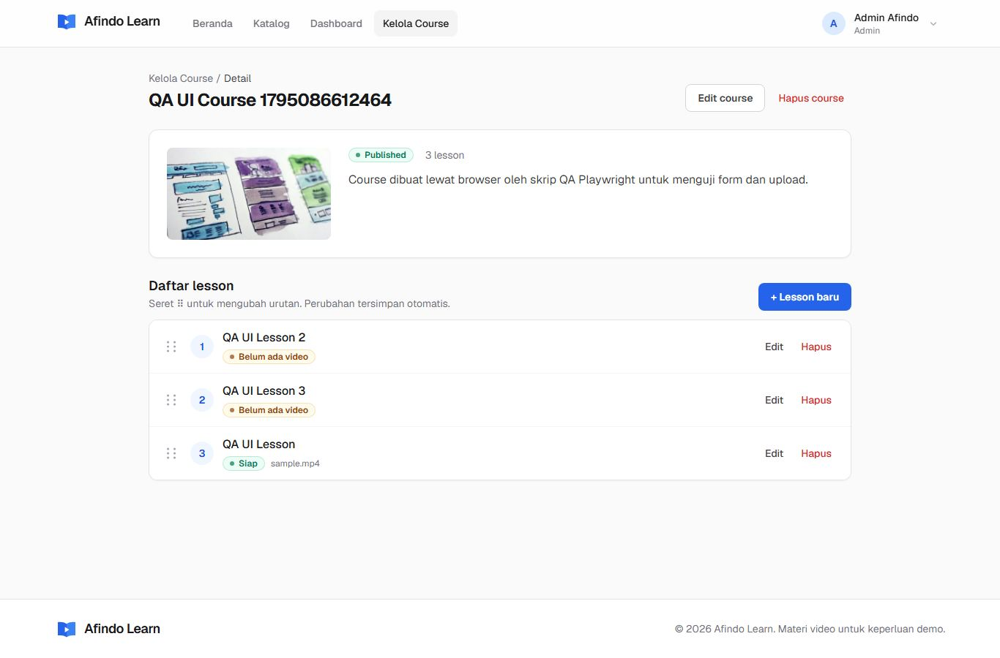 |

| Modal konfirmasi hapus | Detail course (guest) | Player student |
|---|---|---|
| 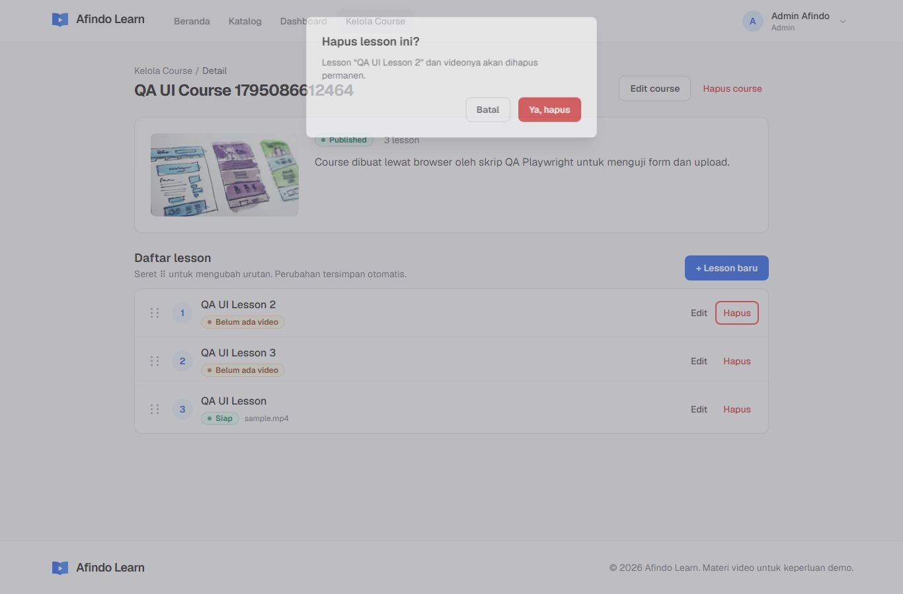 | 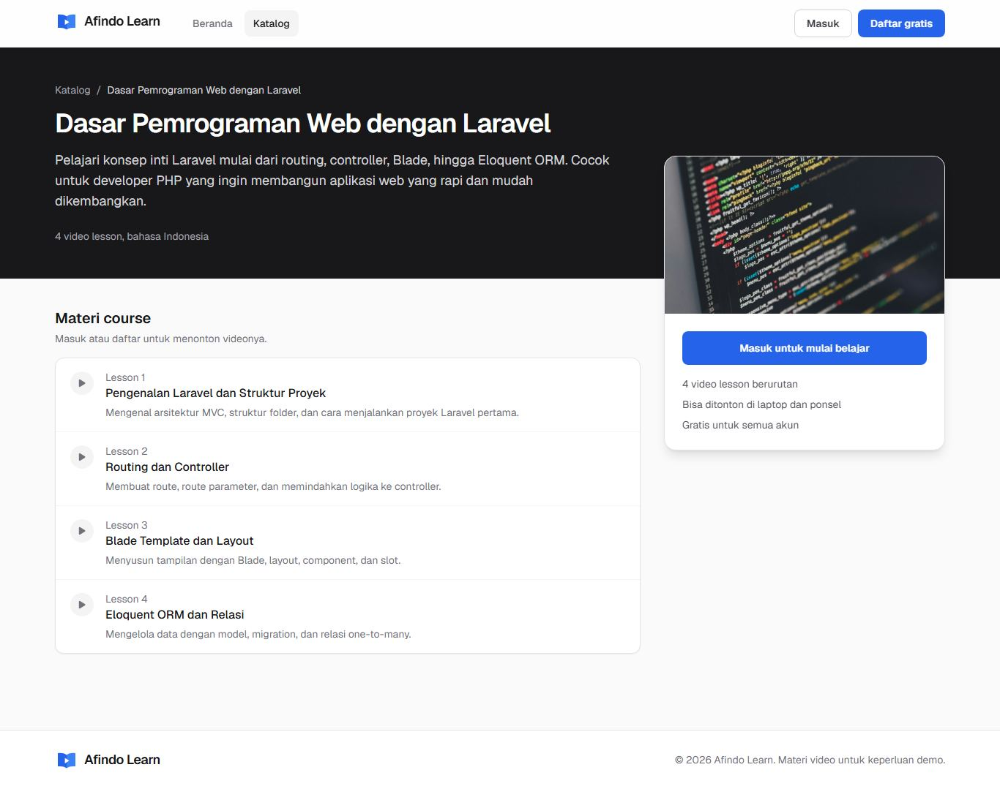 | 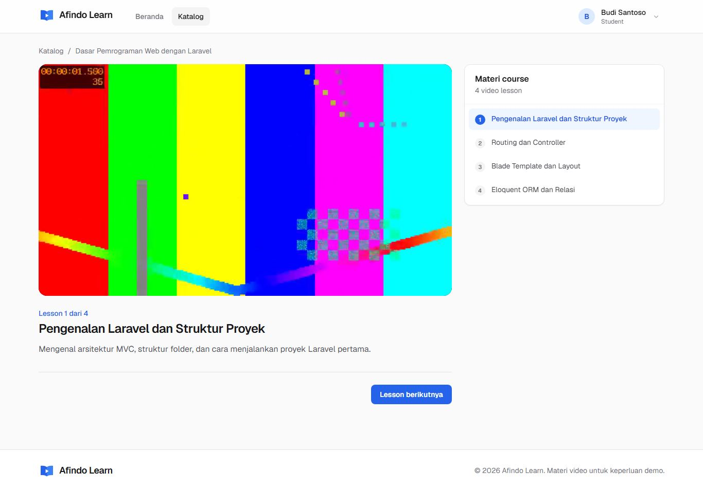 |

| Halaman 403 (student) | Menu mobile | Katalog mobile | Kelola course mobile |
|---|---|---|---|
| 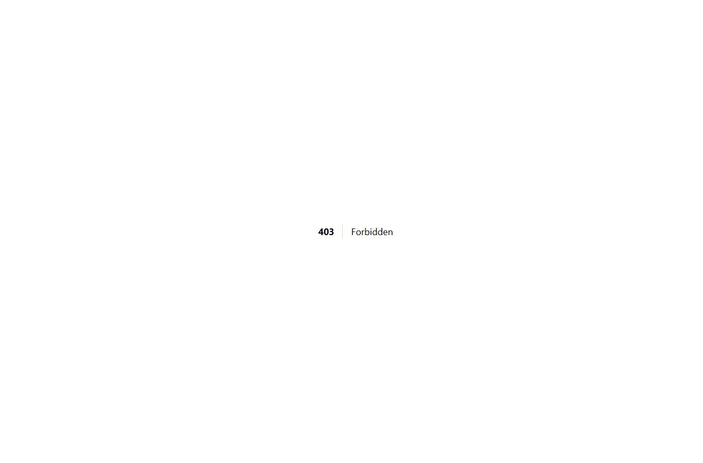 | 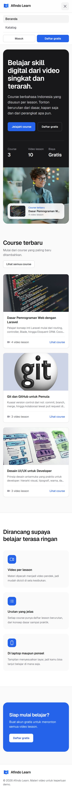 | 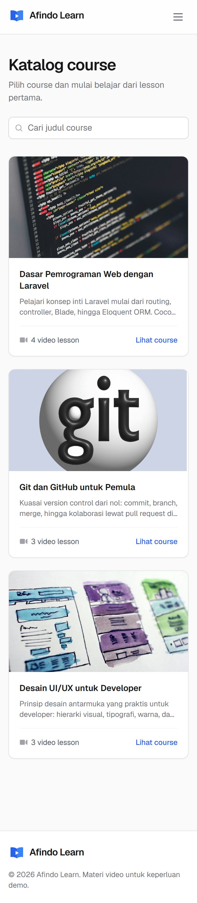 | 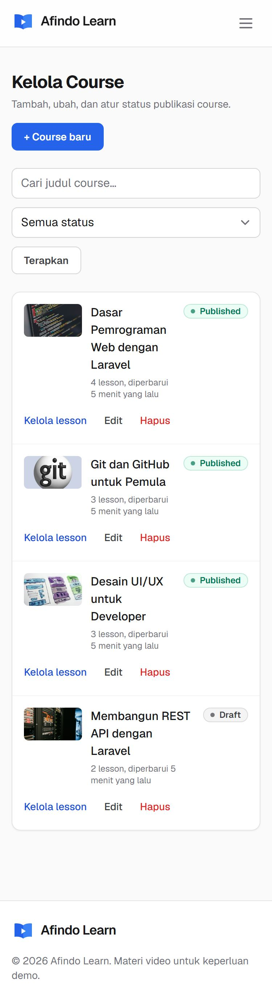 |

## 7. Cara menjalankan ulang

```bash
# 1. Siapkan aplikasi + data demo (disarankan database terpisah, mis. afindo_qa)
php artisan migrate:fresh --seed
php artisan storage:link
php artisan serve            # atau php -S untuk batas upload besar

# 2. Siapkan Playwright (sekali saja)
npm install --no-save playwright
npx playwright install chromium

# 3. Jalankan QA
node tests/e2e/qa-http.mjs   # 35 skenario HTTP
node tests/e2e/qa-ui.mjs     # 15 skenario browser + screenshot
```

Variabel opsional: `BASE_URL` (default `http://127.0.0.1:8000`) dan `APP_ROOT` (default folder kerja). Detail ada di [`tests/e2e/README.md`](../../tests/e2e/README.md).

> **Peringatan:** skrip QA membuat, mengubah, dan menghapus data serta mengunggah file. Jalankan pada database khusus pengujian, bukan database demo/dev yang ingin dipertahankan.

## 8. Kesimpulan

Semua fitur wajib brief (autentikasi + role, CRUD course, CRUD + reorder lesson, upload video, student course view) berjalan end-to-end di MySQL, termasuk aturan akses video privat, CSRF, escaping XSS, dan tampilan responsif. **Aplikasi siap didemokan.**
